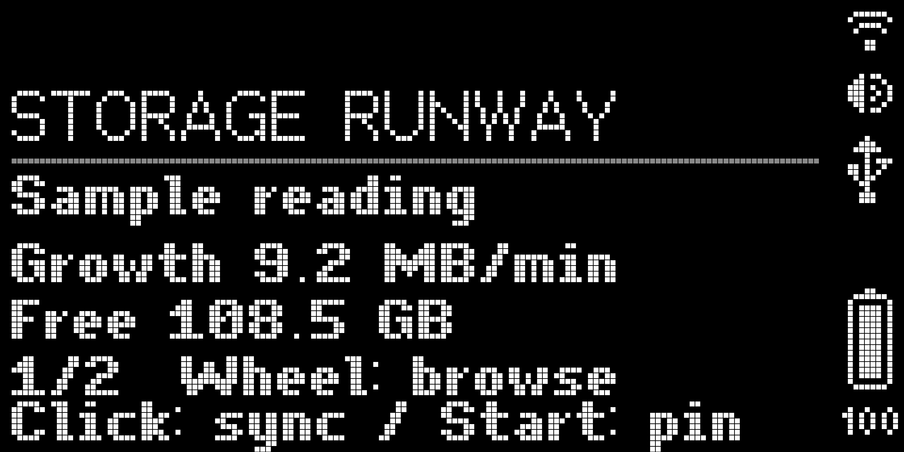
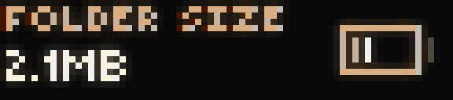

# Storage Runway

Estimate time to fill your recording volume using observed growth of the selected folder.

Disk free space alone cannot tell a camera operator how long a recording can continue. This estimate combines the recording folder’s measured growth with space available on the volume that actually holds it.

## Screen transitions

Browse the growth rate and recording time left. The value sits on the bottom row.


<details>

<summary>Watch the rear display</summary>



</details>

## Measure growth during a capture

1. Select the recording folder and start the capture as usual. Give the companion at least two readings while new data is being written.
2. Read **DISK RUNWAY** for the estimated minutes remaining. The rear gives the current growth rate and free space.
3. Turn to **FOLDER SIZE** to confirm that the selected folder is accumulating allocated data.


## Recheck after changing the capture rate

1. Return to the runway page after changing codec, resolution or frame rate. Allow time for the rolling measurements to reflect the change.
2. Click to refresh the reading. If the folder is flat or shrinking, wait for fresh growth before expecting a time estimate.
3. Read the free capacity on the rear when other work is writing to the same disk.



## Example from the emulator

The controlled recording wrote a 2 MiB file, which appears as about 2.1 decimal MB. The estimated minutes are specific to this volume and the measured interval. They will differ on another computer. The test measured a real local folder and its filesystem capacity over a controlled sampling interval.

## Set up the source

Set folder to your recording directory. The bridge measures allocated bytes with du and free space on that same volume. Give it at least two readings while data is growing. A flat or shrinking folder shows no estimate. The rolling two-minute window adapts as the capture rate changes.

## Connect the bar

Copy companion/example.json to a private config.json and adjust it for your source. From the project folder run `python3 companion/serve.py --config config.json`. Use Python 3.10+. Set Local companion URL to `http://127.0.0.1:8770/reading` on the emulator and allow local port 8770. On hardware, bind the companion to a trusted LAN interface and set its reachable address. The wheel browses pages. Click refreshes. Start pins or unpins the current page. The last good reading is labeled offline after a source error.

## Run in the emulator

Open BUSY Bar Emulator. From this repository, run:

```sh
~/.busy-emulator/bin/busy-emulator dev --once
```

Press **Back** to exit.

The GIFs are excerpts from the emulator recording. Each LED occupies a 16 × 16 cell with a black border. The end frames pause for reading.

[Full recording](media/controls.mp4) · [Rear display](screenshots/back-1.png) · [Firmware test](EMULATOR-QA.md) · [MIT license](LICENSE)
